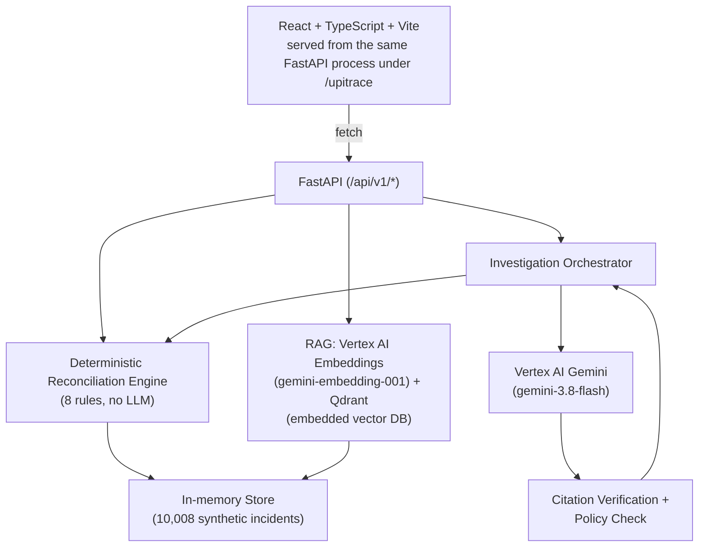

# UPITrace

**Google AI Builder Cup 2026 — JAPAC, BFSI: Intelligent Risk, Fraud & Financial Experiences**
**Team: LATENT MINDS**

AI-assisted investigation for UPI payment incidents where the customer-facing status, provider/gateway records, bank evidence, notification logs, and merchant order status may be incomplete or contradictory.

> 🔗 Live demo: _not yet deployed — see [Deployment](#deployment)_
> 🔗 Public API: _not yet deployed_
> 🔗 GitHub repo: https://github.com/ANJALIBHAGORIA/UPITrace
> 🔗 Demo video: _not yet recorded_

---

## Problem & Motivation

A UPI payment can succeed at the gateway while the merchant's system never confirms the order — the customer sees "paid," the merchant sees "no booking," and nobody can tell which record is authoritative without manually cross-referencing four separate systems (UPI app, payer bank, payment gateway, merchant platform). Existing reconciliation tooling is either purely manual or treats missing/contradictory evidence as a hard failure instead of a distinct, investigable state.

## Proposed Solution

UPITrace correlates evidence across all four sources into one timeline, applies **deterministic reconciliation rules** (not ML — explicit, auditable logic) to classify the incident, retrieves similar historical cases and runbooks via **real semantic search (RAG)**, and — when Vertex AI is configured — asks **Gemini** to produce a structured, evidence-grounded investigation whose citations are verified against the actual evidence store before being shown to anyone.

**Differentiation**: every AI-generated claim is checked against real evidence IDs before display (invented citations are stripped and reported, not trusted); every recommended action is checked against the deterministic rules engine's own permitted actions before being shown (an AI suggestion outside that set is overridden, not followed); and the system is honest about its own limits — if Vertex AI isn't configured, it says so explicitly (`source_mode: UNAVAILABLE`) instead of fabricating a Gemini-shaped answer.

## Key Features

- **Deterministic reconciliation engine** — 8 named rules, independent of any LLM, handling missing/contradictory/duplicate evidence explicitly (e.g., "a missing merchant order is not proof of a failed payment")
- **AI investigation (Gemini on Vertex AI)** — structured summary, competing hypotheses, cited evidence, uncertainty factors, recommended action
- **Citation verification** — any AI-cited evidence ID not present in the real evidence store is stripped and logged, never silently trusted
- **Policy-checked actions** — AI-recommended actions are validated against the reconciliation engine's own permitted actions; violations are overridden
- **RAG-based similar-case retrieval** — real vector search (see [RAG](#rag--vector-search)), with an honest lexical fallback when the index isn't built
- **Cross-platform event timeline** — per-incident view across UPI app, bank, gateway, and merchant sources
- **Interactive demo flow** — simulate a payment → see the merchant-side mismatch → create a real incident from it → watch it investigated end-to-end

### End-to-end investigation workflow

1. **Demo / Create Incident** — simulate or manually report a payment issue
2. **Incident Overview** — auto-runs deterministic reconciliation, shows classification + key findings
3. **Event Timeline** — chronological cross-platform evidence
4. **Evidence Details** — per-source raw records, grouped by UPI App / Bank / Gateway / Merchant
5. **Similar Incidents** — RAG-retrieved comparable past cases + relevant runbooks
6. **AI Analysis** — Gemini-generated summary, hypotheses, cited evidence, uncertainty
7. **Recommended Actions** — the policy-checked action, with a simulated propose → execute → verify flow, plus general dispute-resolution guidance

## Architecture



## Technology Stack

| Layer            | Technology                                                                                              |
| ---------------- | ------------------------------------------------------------------------------------------------------- |
| Frontend         | React 19, TypeScript, Vite, Tailwind CSS v4, react-router-dom                                           |
| Backend          | Python 3.11 (3.9 in local dev), FastAPI, Pydantic v2                                                    |
| AI               | **Vertex AI Gemini** (`gemini-3.8-flash`) via `google-genai` SDK, ADC auth                    |
| RAG / Embeddings | **Vertex AI embeddings** (`gemini-embedding-001`) + **Qdrant** (embedded/local vector DB) |
| Testing          | Pytest (backend),`tsc` + Vite build (frontend)                                                        |
| Planned (Cloud)  | Cloud Run (API + frontend), Firebase Hosting, Firestore                                                 |

## Repository Structure

```
ai_builder_cup/
├── Dockerfile, .dockerignore      # Cloud Run build (built + smoke-tested locally — see Deployment)
├── docs/architecture.md, implementation_plan.md   # detailed, phase-by-phase build log
├── requirements.txt
├── .env.example
└── src/main/
    ├── backend/
    │   ├── models/              # Pydantic domain models
    │   ├── scripts/              # synthetic data generator, RAG index builder, Vertex status check
    │   ├── reconciliation/       # the 8-rule deterministic engine
    │   ├── tools/                 # 9 agent tool connectors (SIMULATED execution)
    │   ├── ai/                   # Gemini providers (Vertex = production; AI Studio = dev/test only)
    │   ├── retrieval/            # embeddings + Qdrant vector index
    │   ├── investigation/        # orchestrator, citation verification
    │   ├── api/                  # FastAPI app and routes
    │   └── tests/                 # 92 tests
    └── frontend/                 # React app, 9 screens
```

## Prerequisites

- Python 3.9+ (3.11 recommended, used in the Docker image)
- Node.js 20+
- A free Google AI Studio key (dev/test) and/or a GCP project with Vertex AI enabled (production)

## Local Setup

### Backend

```bash
cd ai_builder_cup
python3 -m venv .venv
source .venv/bin/activate
pip install -r requirements.txt

cp .env.example .env   # fill in values — see below

# Generate the synthetic dataset (deterministic, no credentials needed)
python -m src.main.backend.scripts.generate_synthetic_data

# Run tests
pytest src/main/backend/tests -q

# Run the API (serves the frontend too, once built — see below)
uvicorn src.main.backend.api.app:app --port 8001 --reload
```

### Frontend

```bash
cd src/main/frontend
npm install
npm run build        # outputs to dist/, served by the backend at /upitrace
# or, for hot-reload dev:
npm run dev           # proxies /api to http://127.0.0.1:8001 (see vite.config.ts)
```

Open **http://127.0.0.1:8001/upitrace** (production build, single origin) or **http://localhost:5173** (Vite dev server).

## Environment Variables

See `.env.example` for the full list. Key ones:

```bash
# Production AI provider — Vertex AI, via Application Default Credentials (no API key)
GOOGLE_CLOUD_PROJECT=upitrace
VERTEX_AI_LOCATION=global          # NOT us-central1 — gemini-3.8-flash generation requires global
VERTEX_AI_GEMINI_MODEL=gemini-3.8-flash
VERTEX_EMBEDDING_MODEL=gemini-embedding-001

# Dev/testing only — free tier, never auto-selected in production
GEMINI_API_KEY=
```

Auth for Vertex AI is via `gcloud auth application-default login` + `gcloud auth application-default set-quota-project <project>` — no service-account key is committed or required for local dev.

## API Reference

Base path: `/api/v1`. Full interactive docs at `/docs` (FastAPI auto-generated) when the server is running.

| Method | Path                                | Purpose                                                                          |
| ------ | ----------------------------------- | -------------------------------------------------------------------------------- |
| GET    | `/health`                         | Liveness + incident count                                                        |
| GET    | `/incidents`                      | List incidents (`?status=` filter)                                             |
| POST   | `/incidents`                      | Create an incident (auto-synthesizes a cross-platform event trail)               |
| GET    | `/incidents/{id}`                 | Fetch one incident                                                               |
| GET    | `/incidents/{id}/events`          | Source events for the timeline                                                   |
| GET    | `/incidents/{id}/evidence`        | Evidence records                                                                 |
| POST   | `/incidents/{id}/reconcile`       | Run the deterministic reconciliation engine                                      |
| POST   | `/incidents/{id}/investigate`     | Run the Gemini investigation (falls back honestly if Vertex AI isn't configured) |
| GET    | `/incidents/{id}/investigation`   | Fetch the last investigation result                                              |
| GET    | `/incidents/{id}/similar-cases`   | RAG semantic search (or lexical fallback)                                        |
| GET    | `/runbooks`                       | List runbooks (`?tag=` filter)                                                 |
| GET    | `/sample-incidents`               | One example per scenario category                                                |
| POST   | `/incidents/{id}/actions/propose` | Propose a policy-checked next action                                             |
| POST   | `/actions/{id}/execute`           | Execute an action (SIMULATED only)                                               |
| POST   | `/actions/{id}/verify`            | Verify the execution outcome                                                     |
| GET    | `/incidents/{id}/audit`           | Audit trail for an incident                                                      |

**Example** — create an incident with synthetic, non-sensitive data:

```bash
curl -X POST http://127.0.0.1:8001/api/v1/incidents \
  -H "Content-Type: application/json" \
  -d '{"title": "Payment to IRCTC not confirmed", "complaint": "test", "amount": "499", "merchant_id": "IRCTC"}'
```

```json
{
  "incident_id": "INC-10010",
  "incident_status": "OPEN",
  "reconciliation_status": null,
  "merchant_id": "IRCTC",
  "amount": "499"
}
```

*(Response shown is representative, verified against a real local run — exact field set per `models/incident.py`.)*

## Testing

**Verified just now, this session:**

```bash
pytest src/main/backend/tests -q
# → 92 passed in ~28s
```

```bash
cd src/main/frontend && npm run build
# → tsc -b (type-check) + vite build — 0 errors
```

This is a **test-suite pass/fail result** (schema validity, reconciliation-rule correctness, citation verification, API contract tests, RAG index round-trip tests) — **not a model-accuracy or fraud-detection-quality metric**. See [Benchmarking](#benchmarking--evaluation) for what that distinction means here.

## Benchmarking & Evaluation

| Component / Task | Metric | Baseline | UPITrace Result | Dataset / Sample Size | Status / Notes |
| --- | --- | --- | --- | --- | --- |
| Backend test suite | Pass/fail | — | **92/92 passing** | 92 unit + integration tests | Previously verified; tests code correctness, not model quality. Re-run before release if code changes. |
| Frontend build/type-check | Pass/fail | — | **0 errors** | — | `tsc -b` + Vite build; previously verified. |
| Reconciliation rule consistency | Match against authored ground truth | — | **36/36 and 10,008/10,008 match** | Synthetic incidents; 12 scenario categories | Self-consistency check against ground truth authored alongside the rules. Does not establish real-world accuracy on unseen data. |
| API: health | Mean / median / p95 latency | — | **1 / 1 / 2 ms** | 10 sequential local requests | Local benchmark only; not cloud latency or load testing. |
| API: reconciliation | Mean / median / p95 latency | — | **4 / 3 / 9 ms** | 10 sequential local requests | Local benchmark only; not cloud latency or load testing. |
| API: investigation | Mean / median / p95 latency | — | **120 / 80 / 249 ms** | 10 sequential local requests | Benchmark observed deterministic fallback, not live Vertex AI generation. |
| API: similar cases | Mean / median / p95 latency | — | **37 / 28 / 69 ms** | 10 sequential local requests | Benchmark observed lexical retrieval only. |
| Similar-case retrieval | Category match @1 | — | **100% (1.000)** | 120 successful queries; 10 per category | Synthetic labels; lexical method only. Top result matched the query incident's scenario category. This is a topical-relevance proxy, not human relevance grading. |
| Similar-case retrieval | Category match @5 | — | **100% (1.000)** | 120 successful queries; top 5 results | Synthetic labels; lexical method only. The query category appeared among returned results. Not a precision/recall evaluation over independently labeled relevant documents. |
| Similar-case retrieval | Methods observed | — | **`lexical` only** | 120 successful queries | The vector index was not active in this benchmark run; these results do not measure semantic/vector retrieval. |
| AI investigation | Live Vertex AI calls | — | **0/24** | 24 investigations; 2 per category | All observed reports used `none (deterministic fallback)`. Do not interpret these as live Gemini quality or latency results. |
| Vertex AI provider integration | Functional check | — | **Pass** | 1 successful live call reported by `check_vertex_status.py` separately from this benchmark | Confirms a live provider call succeeded in a separate check; the benchmark itself made zero live Vertex AI calls. Not a multi-run quality or latency benchmark. |

### Methodology & Limitations

- All 10,008 incidents are **synthetic**, generated by a seeded, deterministic script (`generate_synthetic_data.py`) across 12 hand-authored scenario categories (e.g., merchant confirmation missing, status mismatch, duplicate payment). **None of this is real transaction data.**
- "Reconciliation accuracy" above is a correctness check of the rules engine against its own design intent, not a measurement of how well the rules generalize to real, messy production data.
- Passing unit/integration tests is evidence the code does what it's supposed to do — it is **not** evidence of fraud-detection or investigation-quality performance, and this README does not present it as such.
- **Not yet done, flagged honestly**: no precision/recall evaluation of RAG retrieval, no human evaluation of Gemini's investigation quality, no latency/load benchmarking, no evaluation on real (non-synthetic) incidents.
- **Quickest useful next evaluation** if time allows: a small (20–30 case) human-labeled set of "is this AI summary correct given the evidence?" judgments — this would be the first real quality signal beyond code correctness.

## RAG / Vector Search

- Embeddings: **Vertex AI** `gemini-embedding-001` (3072-dim), via `google-genai` SDK, ADC auth — not Google AI Studio's free embeddings API in production.
- Vector DB: **Qdrant**, running embedded/local (no separate server) — a real vector database (native payload filtering, persistence), not a hand-rolled index file.
- Corpus: 10,008 incidents + 5 runbooks, built via `python -m src.main.backend.scripts.build_rag_index` (a separate, explicit step — not run on server startup, since it costs real API quota/time).
- **Known limitation**: Qdrant's embedded mode allows only one process to hold its storage path at a time — don't run the test suite while the API server is also running against the same data directory (this is a documented Qdrant behavior, not a bug).
- If no index has been built, `/similar-cases` **falls back to lexical (word-overlap) search** and says so explicitly in the response (`method: "lexical"` vs `"semantic_rag"`) — never silently degraded.

## Security, Privacy & Configuration

- `.env` is gitignored and was never committed (verified: `git ls-files` shows only `.env.example`).
- No API keys, tokens, or service-account files were found in any tracked, staged, or diffed file in this repository (verified via pattern scan this session).
- Production AI calls use **Application Default Credentials**, not a committed service-account key.
- AI provider selection is **explicit and does not silently fall back** — if Vertex AI isn't configured, the system returns a clearly-labeled deterministic result (`source_mode: UNAVAILABLE`), never a fabricated Gemini-shaped answer, and never silently substitutes the dev-only AI Studio key.
- All synthetic data is clearly labeled `SYNTHETIC`/`SIMULATED` throughout the UI and API responses; no real customer or transaction data exists in this repository.
- "Alternative Actions" contact numbers/emails shown in the UI are labeled demo placeholders, not verified real support lines.

## Deployment

**Status: prepared, not yet deployed to a live URL.**

### What's verified locally

- `Dockerfile` **built and smoke-tested** this session: `docker build` succeeds, the container boots, `/health` and `/upitrace` both return HTTP 200, 10,008 incidents load correctly inside the container.
- Single-service architecture (FastAPI serves both the API and the built React app from one process/port) — this avoids needing CORS configuration, since everything is same-origin. **No CORS middleware exists or is needed under this architecture.**

### Cloud Run (backend + frontend, single service)

```bash
gcloud run deploy upitrace \
  --source . \
  --region <your-region> \
  --allow-unauthenticated \
  --set-env-vars GOOGLE_CLOUD_PROJECT=upitrace,VERTEX_AI_LOCATION=global,VERTEX_AI_GEMINI_MODEL=gemini-3.8-flash,VERTEX_EMBEDDING_MODEL=gemini-embedding-001
```

Cloud Run's default service identity needs the **Vertex AI User** IAM role granted on the project for ADC to work server-side — not yet verified against a real Cloud Run service (only verified locally via `gcloud auth application-default login`).

After deploy, build the RAG index once against the live service's environment (it needs real Vertex credentials, which aren't available at Docker build time):

```bash
python -m src.main.backend.scripts.build_rag_index
```

### Firebase Hosting / Firestore — not implemented

This repo currently serves the frontend **from the same Cloud Run service**, not from Firebase Hosting. Splitting them would require: (1) a configurable API base URL in the frontend (currently a relative `/api/v1` path, same-origin only), (2) CORS middleware on the backend, (3) a `firebase.json` rewrite config — **none of which exist yet**. Firestore is also not integrated; the backend uses an **in-memory store**, meaning data resets on every restart. Both are planned, not implemented.

## Troubleshooting & Known Limitations

- **In-memory store**: all incidents/investigations/audit records are lost on server restart. Firestore integration (planned) would fix this.
- **Qdrant single-process lock**: see [RAG](#rag--vector-search) above.
- **`VERTEX_AI_LOCATION` must be `global`**, not a regional value like `us-central1`, for `gemini-3.8-flash` generation specifically — confirmed by testing both; embeddings work in both.
- **Python 3.9 in local dev** is past end-of-life (the Docker image uses 3.11); local `google-auth` prints an EOL warning — harmless but should move to 3.11+ locally too.
- No automated security/dependency scanning has been run (e.g., `pip-audit`, `npm audit`) — not yet done.

---

*This README distinguishes **Implemented**, **Tested**, **Verified live**, **Planned**, and **Not measured** throughout — if a claim isn't labeled as verified, treat it as not yet confirmed.*
